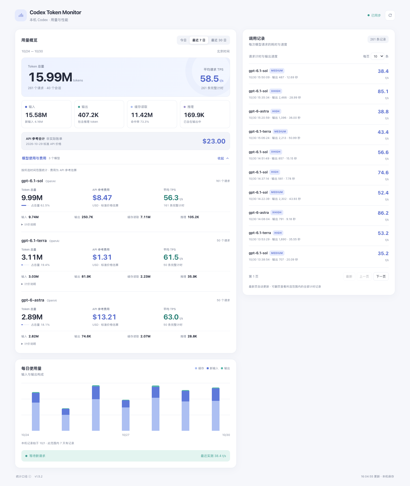
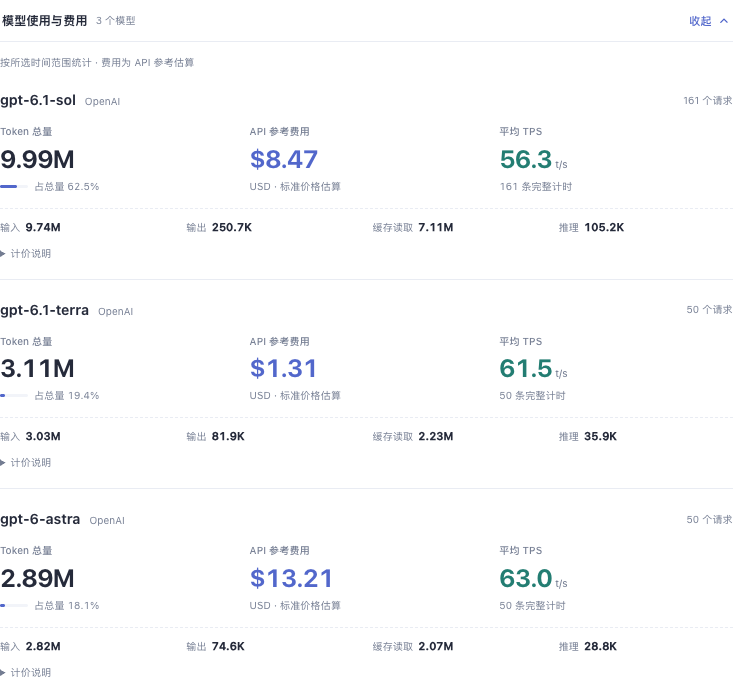

<picture>
  <source media="(prefers-color-scheme: dark)" srcset="docs/assets/readme-cover-dark.svg">
  
</picture>

<p align="center">
  <a href="README.md">简体中文</a> · <strong>English</strong>
</p>

<p align="center">
  <a href="CHANGELOG.md"></a>
  
  
  <a href="LICENSE"></a>
</p>

<p align="center">
  <a href="#quick-start">Quick start</a> ·
  <a href="#screenshots">Screenshots</a> ·
  <a href="docs/getting-started.md">Documentation</a> ·
  <a href="CONTRIBUTING.md">Contributing</a>
</p>

**Codex Token Monitor** is a local dashboard for Codex usage and request performance. See how many tokens you used, which models account for them, how fast requests complete, and their estimated cost at standard API prices.

The collector and MCP server use the **Python standard library**. Statistics stay in a local SQLite database. Open the dashboard in a browser or connect it to a client that supports stdio MCP.

<picture>
  <source media="(prefers-color-scheme: dark)" srcset="docs/screenshots/dashboard-v1.5.2-dark.png">
  
</picture>

<p align="center"><sub>v1.5.2 application UI · Expanded model metrics · Synthetic demo data</sub></p>

## Features

- **Usage and trends** — Inspect input, output, cached input and reasoning tokens for today, the last 7 days or the last 30 days.
- **Model comparison** — Compare total tokens, estimated API cost and average TPS side by side, with usage shares and timing sample counts.
- **Request history** — Inspect model, reasoning effort, output tokens, duration and TPS. Browse history with 10, 20 or 50 records per page.
- **Local collection** — Read local Codex sessions and telemetry. The service listens only on loopback; refreshing the dashboard does not call a model.

## Screenshots

### Compare models at a glance

Three aligned metrics make tokens, estimated cost and throughput easy to compare. Token composition appears underneath, with unit prices available on demand. Missing prices and incomplete timing are marked explicitly.

<picture>
  <source media="(prefers-color-scheme: dark)" srcset="docs/screenshots/models-v1.5.2-dark.png">
  
</picture>

<details>
<summary><strong>Narrow-screen preview</strong> — A single-column dashboard with three-column model metrics</summary>

<p align="center">
  
</p>

Full pages: [Narrow-screen dashboard](docs/screenshots/dashboard-v1.5.2-mobile.png) · [Dark desktop](docs/screenshots/dashboard-v1.5.2-dark.png)

</details>

Screenshots show the real application with isolated, synthetic data. [View screenshot generation instructions](docs/screenshots/README.md)

## Quick start

Requires **Python 3.9+**. The commands below target macOS / Linux. No third-party Python packages are needed to run the project.

### Try the demo

```sh
git clone https://github.com/shy3130/codex-token-monitor.git
cd codex-token-monitor
python3 scripts/demo.py
```

Open **[http://127.0.0.1:8877](http://127.0.0.1:8877/)**. The demo creates 30 days of synthetic data in memory and does not read your Codex sessions. Press `Ctrl+C` to stop.

### Monitor your own usage

From the project root:

```sh
python3 monitor.py --port 8765
```

Open **[http://127.0.0.1:8765](http://127.0.0.1:8765/)**. The service scans `~/.codex/sessions` and `~/.codex/archived_sessions` and stores statistics in `data/metrics.sqlite3`.

**Token statistics can be rebuilt from existing sessions. TPS requires Codex telemetry.** Merge the [OTLP JSON example](examples/codex-otel.toml) into your user-level Codex configuration, restart Codex and complete a new request. The collector requires JSON; it does not parse OTLP Protobuf or gRPC.

See [Setup and configuration](docs/getting-started.md) for existing configuration entries, custom ports and directories, backups, updates and troubleshooting. Detailed documentation is currently in Chinese.

## MCP integration

Run the collector separately. The MCP server reads its local HTTP endpoints.

1. Start `monitor.py` and confirm that its dashboard opens in your browser.
2. Copy the [MCP client example](examples/mcp-client.json), replacing the `plugin/server.py` placeholder with its actual absolute path.
3. Merge it into your client's MCP settings. If you choose a different port, update `TOKEN_MONITOR_BACKEND_URL` as well.

| Tool | Purpose |
| --- | --- |
| `open_token_monitor` | Open the dashboard in clients that support MCP Apps |
| `get_token_usage` | Read token usage, model statistics, TPS and estimated API costs |
| `get_request_history` | Read request timings by period, page size and cursor |

Standard stdio MCP interaction is supported. Rendering the dashboard depends on the client's MCP Apps support; other products have not been individually verified. Client configuration locations and installation flows vary.

## How measurements work

| Metric | Definition |
| --- | --- |
| Time ranges | Beijing calendar days; 7-day and 30-day ranges include today |
| Total tokens | Input + output; cached tokens are included in input, and reasoning tokens in output |
| Average TPS | Total output tokens from fully timed requests ÷ their total duration, including initial wait and reasoning, excluding tools between requests |
| Estimated API cost | Calculated per model from the bundled **2026-10-29** standard text-token price snapshot; models without a known price are excluded from the sum |

Costs are estimates, not actual invoices, subscription charges or remaining allowances. Tool charges and other fees are not included. The price table does not update automatically. Source links: [OpenAI API pricing](https://developers.openai.com/api/docs/pricing), [Z.ai pricing](https://docs.z.ai/guides/overview/pricing).

Collection currently covers **local Codex sessions and telemetry**. Other MCP clients can view those statistics, but their own calls and ordinary ChatGPT web or mobile chats are not automatically collected. The statistics database stores counts, models, reasoning settings, and session/request identifiers; it does not intentionally store prompts or model responses.

## Documentation

| Task | Guide |
| --- | --- |
| Install, configure telemetry or troubleshoot | [Setup and configuration](docs/getting-started.md) |
| Configure a client | [MCP example](examples/mcp-client.json) · [Telemetry example](examples/codex-otel.toml) |
| Develop, test or update a local copy | [Contributing](CONTRIBUTING.md) |
| Recreate the screenshots | [Demo and screenshots](docs/screenshots/README.md) |
| Follow version changes | [Changelog](CHANGELOG.md) |

## Development and contributions

Bug reports, feature requests, documentation improvements and pull requests are welcome. Read the [contribution guide](CONTRIBUTING.md) for the project structure and development workflow.

```sh
# Python unit tests and HTTP / MCP integration
PYTHONDONTWRITEBYTECODE=1 python3 -m unittest discover -s . -p 'test_*.py'
PYTHONDONTWRITEBYTECODE=1 python3 tests/integration_smoke.py

# UI script tests; requires Node.js
node --test tests/test_ui.js
```

Tests use synthetic data, temporary directories and temporary ports. The [GitHub Actions workflow](.github/workflows/ci.yml) defines Python checks on Linux / macOS and Node.js UI tests. Node.js is only needed for development checks and optional screenshots.

[Report a bug](https://github.com/shy3130/codex-token-monitor/issues/new/choose) · [Suggest an improvement](https://github.com/shy3130/codex-token-monitor/issues) · [Contribution guide](CONTRIBUTING.md)

## License

[MIT](LICENSE) © 2026 [shy3130](https://github.com/shy3130)
