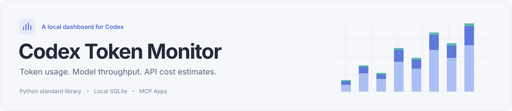
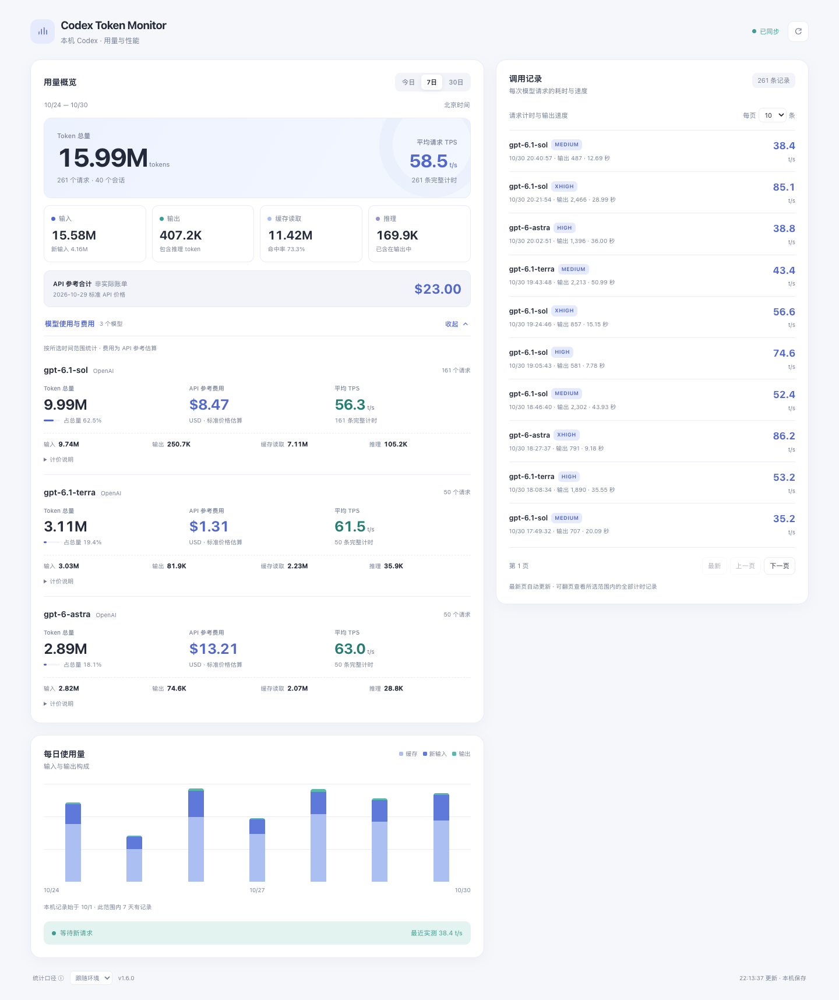
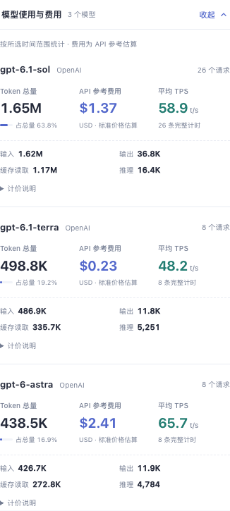

<picture>
  <source media="(prefers-color-scheme: dark)" srcset="docs/assets/readme-cover-dark.svg">
  
</picture>

<p align="center">
  <strong>简体中文</strong> · <a href="README.en.md">English</a>
</p>

<p align="center">
  <a href="CHANGELOG.md"></a>
  
  
  <a href="LICENSE"></a>
</p>

<p align="center">
  <a href="#快速开始">快速开始</a> ·
  <a href="#界面预览">界面预览</a> ·
  <a href="docs/getting-started.md">使用文档</a> ·
  <a href="CONTRIBUTING.md">参与贡献</a>
</p>

**Codex Token Monitor** 是一个在本机运行的 Codex 用量与性能面板。查看今天用了多少 Token、哪个模型消耗最多、每次请求有多快，以及按 API 标准价格折算的参考费用。

采集服务与 MCP 服务均使用 **Python 标准库**，统计数据保存在本地 SQLite；可直接在浏览器查看，也可接入支持 stdio MCP 的客户端。

<picture>
  <source media="(prefers-color-scheme: dark)" srcset="docs/screenshots/dashboard-v1.6.0-dark.png">
  
</picture>

<p align="center"><sub>v1.6.0 实际界面 · 模型明细已展开 · 截图使用虚构演示数据</sub></p>

## 功能

- **看用量** — 按今日、最近 7 日、最近 30 日查看输入、输出、缓存读取和推理 Token，配合小时或每日趋势。
- **比模型** — 每个模型的 Token 总量、API 参考费用、平均 TPS 三列并排显示，附用量占比和完整计时样本数。
- **查请求** — 查看单次请求的模型、思考强度、输出量、耗时和 TPS，支持每页 10 / 20 / 50 条及历史翻页。
- **中英切换** — 默认跟随宿主语言，浏览器独立打开时跟随浏览器；页脚可选择“跟随环境 / 中文 / English”。
- **留在本机** — 从本机 Codex 会话和遥测采集，服务只监听回环地址，界面刷新不额外调用模型。

## 界面预览

### 按模型比较用量、费用与速度

主指标直接对齐展示，输入、输出、缓存和推理放在下一层。标准单价可按需展开；没有价格或完整计时的项目会明确标注。

<picture>
  <source media="(prefers-color-scheme: dark)" srcset="docs/screenshots/models-v1.6.0-dark.png">
  
</picture>

<details>
<summary><strong>查看窄屏布局</strong> — 单列总览与调用记录，保留三列模型主指标</summary>

<p align="center">
  
</p>

完整页面：[窄屏总览](docs/screenshots/dashboard-v1.6.0-mobile.png) · [深色桌面](docs/screenshots/dashboard-v1.6.0-dark.png)

</details>

所有展示图均来自项目实际界面，使用独立的虚构数据。[查看截图与生成方式](docs/screenshots/README.md)

## 快速开始

需要 **Python 3.9+**。以下命令适用于 macOS / Linux，运行服务无需安装第三方 Python 包。

### 先体验界面

```sh
git clone https://github.com/shy3130/codex-token-monitor.git
cd codex-token-monitor
python3 scripts/demo.py
```

打开 **[http://127.0.0.1:8877](http://127.0.0.1:8877/)**。演示内置最近 30 日的虚构数据，仅使用内存数据库，不读取你的 Codex 会话。按 `Ctrl+C` 停止。

### 采集自己的 Codex 用量

在项目根目录启动：

```sh
python3 monitor.py --port 8765
```

打开 **[http://127.0.0.1:8765](http://127.0.0.1:8765/)**。服务会扫描 `~/.codex/sessions` 和 `~/.codex/archived_sessions`，将统计结果写入 `data/metrics.sqlite3`。

**Token 统计可从已有会话重建；TPS 需要启用 Codex 遥测。** 按 [安装与配置](docs/getting-started.md#2-启用请求-tps) 合并 [OTLP JSON 配置](examples/codex-otel.toml)，重启 Codex 并完成一次新请求，即可开始采集请求计时。

自定义端口、Codex 数据目录、数据备份和更新步骤均见 [完整使用文档](docs/getting-started.md)。

## 接入 MCP

采集服务独立运行，MCP 服务通过本机 HTTP 接口读取结果。

1. 启动 `monitor.py`，确认浏览器可以打开本机面板。
2. 参考 [MCP 客户端配置示例](examples/mcp-client.json)，将 `plugin/server.py` 改为本机实际绝对路径。
3. 将配置合并到客户端的 MCP 设置；使用其他端口时，同步修改 `TOKEN_MONITOR_BACKEND_URL`。

| 工具 | 用途 |
| --- | --- |
| `open_token_monitor` | 打开图形面板，需客户端支持 MCP Apps |
| `get_token_usage` | 读取 Token、模型、TPS 与参考费用统计 |
| `get_request_history` | 按时间范围、条数和游标读取请求计时记录 |

支持通用 stdio MCP 交互；图形面板的显示取决于客户端的 MCP Apps 支持。不同客户端的配置位置和安装流程可能不同，详见 [MCP 接入说明](docs/getting-started.md#3-接入-mcp-客户端可选)。

## 界面语言

默认“跟随环境”：优先读取 MCP Apps 宿主语言、宿主写入的页面语言或旧版 OpenAI 桥接语言，工具提供的语言作为补充；独立浏览器页面使用浏览器语言。中文变体目前统一显示简体中文，英文保留地区日期和数字格式，其他语言回退到英文。

页脚可手动选择“中文”或“English”。支持时将选择保存到组件状态，并以浏览器存储作为尽力保留的后备；切换语言会保留所选范围、历史页码和明细展开状态。统计时区始终为**北京时间（UTC+8）**。宿主切换语言后需发出语言更新或更新页面语言才能实时跟随，否则可重新打开面板或手动切换。插件目录简介和示例提示语采用静态中英双语。

## 统计说明

| 指标 | 计算口径 |
| --- | --- |
| 时间范围 | 按北京时间自然日统计；最近 7 日、30 日均包含今天 |
| Token 总量 | 输入 + 输出；缓存读取已包含在输入中，推理已包含在输出中 |
| 平均 TPS | 完整计时请求的总输出 Token ÷ 总耗时；包含首字等待与推理，排除请求间的工具耗时 |
| API 参考费用 | 按模型分别估算后汇总；使用内置的 **2026-10-29** 标准文本价格快照，未知价格模型不计入合计 |

费用是参考估算，不代表实际账单、订阅扣费或剩余额度；工具等其他收费项未计入。价格来源链接保留在 [OpenAI API 定价](https://developers.openai.com/api/docs/pricing) 与 [Z.ai 定价](https://docs.z.ai/guides/overview/pricing)，项目不会自动更新价格表。

当前采集源是 **本机 Codex 会话与遥测**。其他 MCP 客户端可以查看这些数据，但不会自动采集其自身调用，也不包含普通 ChatGPT 网页或移动端会话。统计数据库保存数量、模型、思考强度和会话／请求标识等信息，不有意保存提示词或模型回复。

## 文档

| 我想…… | 从这里开始 |
| --- | --- |
| 安装、配置遥测、处理常见问题 | [安装与配置](docs/getting-started.md) |
| 接入 MCP 或调整配置 | [MCP 示例](examples/mcp-client.json) · [遥测示例](examples/codex-otel.toml) |
| 开发、测试、更新本机副本 | [贡献指南](CONTRIBUTING.md) |
| 重新生成展示图 | [演示与截图](docs/screenshots/README.md) |
| 了解版本变化 | [更新记录](CHANGELOG.md) |

## 开发与贡献

欢迎提交 Bug、功能建议、文档改进和 Pull Request。[贡献指南](CONTRIBUTING.md) 包含项目结构、开发约定及界面验证方式。

```sh
# Python 单元测试与 HTTP / MCP 端到端验证
PYTHONDONTWRITEBYTECODE=1 python3 -m unittest discover -s . -p 'test_*.py'
PYTHONDONTWRITEBYTECODE=1 python3 tests/integration_smoke.py

# 界面脚本测试，需要 Node.js
node --test tests/test_ui.js
```

测试使用虚构数据、临时目录和临时端口。[GitHub Actions](.github/workflows/ci.yml) 配置了 Linux / macOS 的 Python 检查与 Node.js 界面测试。Node.js 仅用于开发验证及可选截图，运行项目无需 Node.js。

[报告问题](https://github.com/shy3130/codex-token-monitor/issues/new/choose) · [提出改进](https://github.com/shy3130/codex-token-monitor/issues) · [查看贡献指南](CONTRIBUTING.md)

## 许可证

[MIT](LICENSE) © 2026 [shy3130](https://github.com/shy3130)
